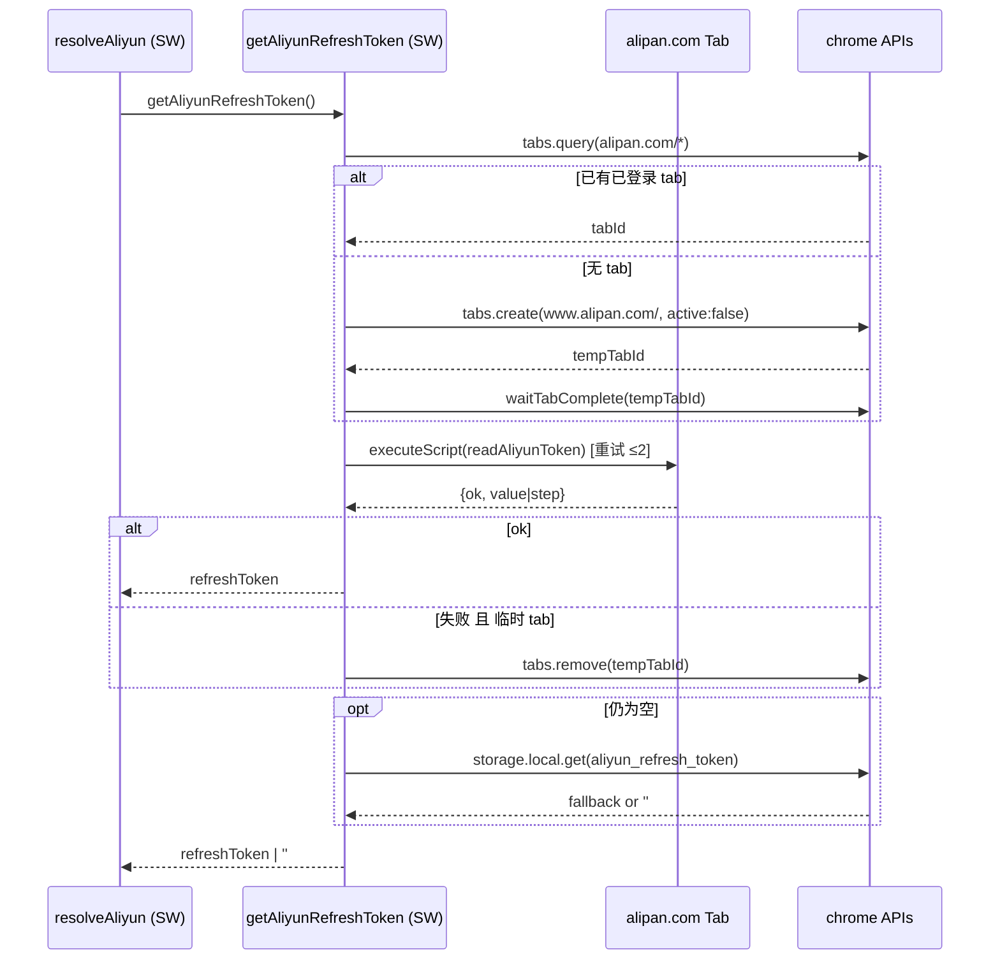
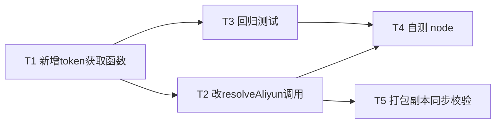

# 阿里云盘解析 · Token 获取增量设计（software-architect / 高见远）

> 范围：为已有桌面下载器 Lele_download 的阿里云盘解析做**增量修复**——修 `resolveAliyun` 的 refresh_token 获取路径。
> 本文档仅产出设计，不含完整实现代码。

---

## 0. 背景与结论

### 已核实事实（主理人读代码确认）
- `extension/background.js` 的 `resolveAliyun(url, pwd)` 位于 **L688–773**，L706–773 的全链路 API 调用本身正确：
  - 用 `refresh_token` 换 `access_token`（auth.alipan.com）
  - 用 `share_id + 提取码` 换 `share_token`（api.alipan.com）
  - 分页列文件（带 `x-share-token` / `Authorization: Bearer` / `X-Canary`）
  - 逐文件换直链 `download_url`，输出 `{name, size, url, headers:{Referer, User-Agent}}`
  - 这一整段在 SW 内用 refresh_token/access_token 作凭证，**不依赖 alipan.com 的 cookie**。
- **唯一断点**在 **L690–704**：`resolveAliyun` 用 `getCookieString('https://www.alipan.com'/'https://www.aliyundrive.com')` 再正则 `refresh_token=([^;]+)` 取 token——但阿里 web 端的 token 存在 **localStorage（key 名 `token`）**，不在 cookie，所以此步必失败；失败后回退读 `chrome.storage.local.aliyun_refresh_token`，而**没有任何 UI 入口能写入该值**（只能 devtools 手工 set）。结果：普通用户解析阿里必抛「未检测到阿里云盘 refresh_token」。
- 分发/识别/UI/后端都已接好，无需改：`resolveNetdisk` switch L1052 `case 'aliyun' → resolveAliyun`、`detectNetdiskPlatform` L349 已识别 `aliyun`/`alipan`、`NetdiskPanel.tsx` L30 已有「阿里云盘」平台选项与中文报错透传、Rust 后端 `commands.rs`/`main.rs` 平台无关透传 + SSRF 校验。

### 用户决策（已拍板）
**零配置自动读取**：扩展注入脚本到用户已登录的 alipan.com 标签页，读取 `localStorage.getItem('token')` 解析出 `refresh_token`，与夸克的零配置体验一致。保留 `chrome.storage.local.aliyun_refresh_token` 作为兜底（devtools 仍可设）。

### 结论
- **改动范围**：仅 `extension/background.js`（新增 2~3 个函数 + 替换 L690–704 共 15 行）。
- `manifest.json` / `NetdiskPanel.tsx` / `commands.rs` / `main.rs` / `build.mjs` **均无需改**。
- 复用夸克既有范式：`getQuarkPageTab` / `waitTabComplete`（L601–609）/ `chrome.scripting.executeScript` 注入，对齐其"找/开标签页 → 注入读 localStorage → 取 token → 用完关 tab"机制。

---

## 1. 实现方案

### 1.1 新增注入函数 `readAliyunToken()`（页面上下文执行）

- **运行环境**：通过 `chrome.scripting.executeScript({ target:{tabId}, func: readAliyunToken })` 注入到 alipan.com 标签页的页面上下文。
- **职责**：读取 `localStorage.getItem('token')` → `JSON.parse` → 提取 `refresh_token`（兼容驼峰 `refreshToken`）→ 返回结构化结果。
- **为什么必须永不抛错（关键）**：`executeScript` 注入的函数若 `throw`，结果会被吞成 `result:null`，SW 侧无法区分「未登录 / 未解析到 / 脚本上下文被销毁」，排错困难。参照夸克 `quarkApiFetch`（L489 起）的 `{ok, step, ...}` 风格，让 SW 侧据 `step` 精准报错。
- **返回结构（设计规格）**：
  - 成功：`{ ok: true, value: '<refresh_token>' }`
  - `localStorage.token` 不存在：`{ ok: false, step: 'local-storage-empty', reason: 'localStorage.token 不存在（可能未登录）' }`
  - JSON 解析失败：`{ ok: false, step: 'json-parse', reason: 'token 不是合法 JSON' }`
  - 无 `refresh_token` 字段：`{ ok: false, step: 'field-missing', reason: 'token 对象无 refresh_token 字段' }`
  - 任何异常：`{ ok: false, step: 'exception', reason: String(err) }`
- **约束**：必须是 self-contained 纯函数，只使用页面上下文的 `localStorage` / `JSON`，**不得引用 SW 作用域的变量或 helper**（`executeScript` 会序列化该函数，闭包不可用）。

### 1.2 新增 `getAliyunRefreshToken()`（SW 侧协调）

职责与流程（对齐夸克 `resolveQuark` L612–677，但极简化——因为阿里只需要 token，不需要像夸克那样在页面上下文跑整条 API）：

1. **优先复用已开的 alipan 标签页**：调用新加的 `getAliyunPageTab()`（仿 `getQuarkPageTab` L592，用 `chrome.tabs.query` 命中 `['https://www.alipan.com/*','https://alipan.com/*','https://www.aliyundrive.com/*','https://aliyundrive.com/*']`，返回 `tabs[0].id` 或 `null`）。
2. **若无已开 tab**：`chrome.tabs.create({ url: 'https://www.alipan.com/', active: false })` 开临时后台页 → `tempTabId`，`await waitTabComplete(tempTabId)`（**直接复用现有** `waitTabComplete`，L601–609）→ `tabId = tempTabId`。
3. **稳定延时**（~1200ms，对齐夸克 1500ms）后再注入，避免 SPA 未就绪导致执行上下文被销毁。
4. **注入 `readAliyunToken`**：重试 `for attempt<2`（与夸克一致，应对注入时页面跳转/上下文销毁）：
   - `lastRes = await chrome.scripting.executeScript({ target:{tabId}, func: readAliyunToken })`
   - `r = lastRes && lastRes[0] && lastRes[0].result`
   - 若 `r && r.ok && r.value` → `return r.value`
   - 若 `executeScript` 直接 `reject`（上下文销毁）→ 记日志，进入下一轮重试
5. **`finally`**：若 `tempTabId != null` → `chrome.tabs.remove(tempTabId)`（用完关，不留残留 tab）。
6. **兜底**：读 `chrome.storage.local.aliyun_refresh_token`（devtools 可设），有则 `return`。
7. **全失败** → `return ''`。

- **返回值**：`string`（refresh_token 或 `''`）。内部用 `console.log('[aliyun] ...')` 打 `step` 便于排错。
- **错误处理哲学**：本函数**不抛错**，返回 `''`；由 `resolveAliyun` 统一抛中文错误（保持现有文案风格），确保「未登录/无 tab 时明确报错，非空白」。

#### 流程图（token 获取主链路）



### 1.3 与夸克范式对照

| 维度 | 夸克 `resolveQuark` | 阿里 `getAliyunRefreshToken` |
|---|---|---|
| 找 tab | `getQuarkPageTab` (`pan.quark.cn/s/*`) | `getAliyunPageTab` (`alipan.com/*`) |
| 临时 tab | `tabs.create(pan.quark.cn/s/<pwdId>)` | `tabs.create(www.alipan.com/)` |
| 稳定延时 | 1500ms | 1200ms |
| 注入函数 | `quarkApiFetch`（整条 API 在页面跑） | `readAliyunToken`（仅读 token） |
| 重试 | 2 次 | 2 次 |
| `finally` 关 tab | 是 | 是 |
| 兜底 | 无（夸克必须登录） | `chrome.storage.local.aliyun_refresh_token` |

> 注：阿里 token 仅用于 SW 侧后续的 OAuth 式 API 调用（`Authorization: Bearer`），**无需像夸克那样把 cookie 透传回 App 下载引擎**，故注入函数极简——这是与夸克最大的区别，也是改动低风险的根因。

---

## 2. resolveAliyun 最小改动（行级）

- **仅替换 L688 函数体内的 L690–704（原 15 行）为调用 `getAliyunRefreshToken()`。L706–773 一字不动。**
- 精确改动说明（伪 diff，仅展示被替换的区块，非完整实现）：

```
// ============ 删除原 L690–704 整段 ============
-  let refreshToken = '';
-  for (const site of ['https://www.alipan.com', 'https://www.aliyundrive.com']) {
-    const ck = await getCookieString(site);
-    const m = (ck.match(/refresh_token=([^;]+)/) || [])[1];
-    if (m) { refreshToken = decodeURIComponent(m); break; }
-  }
-  if (!refreshToken) {
-    refreshToken = await new Promise((res) => {
-      try { chrome.storage.local.get(['aliyun_refresh_token'], (r) => res((r && r.aliyun_refresh_token) || '')); }
-      catch (_) { res(''); }
-    });
-  }
-  if (!refreshToken) {
-    throw new Error('未检测到阿里云盘 refresh_token：请先在 alipan.com 登录；若仍失败，可在扩展存储手动配置 chrome.storage.local.set({aliyun_refresh_token:"..."})');
-  }

// ============ 替换为以下 4 行 ============
+  const refreshToken = await getAliyunRefreshToken();
+  if (!refreshToken) {
+    throw new Error('未检测到阿里云盘 refresh_token：请先在 alipan.com 登录（扩展会自动读取登录态）；若仍失败，可在扩展存储手动配置 chrome.storage.local.set({aliyun_refresh_token:"..."})');
+  }
```

- **新增函数插入位置**：建议放在 **L677（`resolveQuark` 结束）之后、L679（`// 阿里云盘` 注释）之前**，即 `ALI_CANARY` 常量（L686）之前。新增 `readAliyunToken` / `getAliyunRefreshToken` / `getAliyunPageTab` 三个函数。
- `getCookieString(...)`（L357）在本改动中不再被 `resolveAliyun` 调用，但**保留不删**（百度等解析器仍依赖），避免误伤。

---

## 3. 文件列表 + 相对路径 + 行号

| 文件 | 是否需改 | 说明 |
|---|---|---|
| `extension/background.js` | **是** | 新增 `readAliyunToken` / `getAliyunRefreshToken` / `getAliyunPageTab`（约 L677 后插入）；替换 `resolveAliyun` L690–704（15→4 行）；L706–773、`resolveNetdisk` L1052、`detectNetdiskPlatform` L345–355 均不改。 |
| `extension/manifest.json` | 否 | 已声明 `tabs` / `cookies` / `scripting` / `storage` + `host_permissions: <all_urls>`，覆盖 `chrome.tabs.query/create/remove`、`chrome.scripting.executeScript` 所需全部权限。**无需改。** |
| `src/components/NetdiskPanel.tsx` | 否 | L30 已含 `aliyun` 平台选项与中文识别；错误文案由扩展 `p.error` 透传（L77 `setError(p.error \|\| '解析失败')`），扩展侧已抛中文错误。无需改（后续可补 alipan 示例链接占位，非必需）。 |
| `src-tauri/src/commands.rs` | 否 | `request_netdisk_resolve` 平台无关透传 + SSRF 校验，无需改。 |
| `src-tauri/src/main.rs` | 否 | `/api/netdisk/resolve/{pending,result}` 平台无关，无需改。 |
| `build.mjs` | 否 | L18 `cpSync` 已用 `filter: s => !basename(s).startsWith('test-')` 排除 `test-*`；新增的 `test-aliyun.mjs` 不会被打进 `src-tauri/extension` 副本。无需改。 |
| `extension/test-aliyun.mjs` | **新增（测试，不进包）** | 回归测试，见任务 T3。 |

---

## 4. 任务列表（有序 + 依赖）

| ID | 名称 | 源文件 | 依赖 | 优先级 |
|---|---|---|---|---|
| **T1** | 新增 `getAliyunRefreshToken` / `getAliyunPageTab` / `readAliyunToken`（含临时 tab 逻辑、注入永不抛错、结构化返回、storage 兜底） | `extension/background.js` | — | P0 |
| **T2** | 改 `resolveAliyun` 调用（替换 L690–704 为 4 行调用 `getAliyunRefreshToken`） | `extension/background.js` | T1 | P0 |
| **T3** | 回归测试 `extension/test-aliyun.mjs`（内联镜像 `resolveAliyun` + 注入函数；mock `fetch`/`chrome`；覆盖公开/带码/码错/storage 兜底/无 tab 临时页；**注意 Node 下 `navigator` 只读，勿手动赋值**） | `extension/test-aliyun.mjs` | T1（镜像需与 T1 同步） | P1 |
| **T4** | 自测 `node --check extension/background.js` + `node --test extension/test-aliyun.mjs` | 无源码改动 | T2, T3 | P0 |
| **T5** | 确认打包副本同步——`build.mjs` L18 cpSync 已含且排除 `test-*`；重新 build 后比对 `src-tauri/extension/background.js` 与根 `extension/background.js` 一致、且 `src-tauri/extension/test-aliyun.mjs` 不存在 | `build.mjs`（仅验证，不改） | T2 | P2 |

**依赖关系图**：
- `T1 → T2`（T2 依赖 T1 的函数）
- `T1 → T3`（测试镜像需与 T1 对齐；T3 可与 T2 并行）
- `T2 + T3 → T4`
- `T2 → T5`



---

## 5. 依赖与风险

### 依赖
- **manifest 权限**：已齐（`tabs` / `scripting` / `cookies` / `storage` / `<all_urls>`）。**无需申请新权限。**
- **Node 测试环境**：`navigator` 在 Node 18+ 是只读全局（`Object.defineProperty` 固定 `writable:false`）。测试里 **禁止** `navigator = {...}` 或 `global.navigator = {...}`（会 `TypeError`）。正确做法：直接依赖 Node 内置 `navigator.userAgent`，或 `Object.defineProperty(globalThis, 'navigator', { value:{userAgent:'test'}, configurable:true })` 覆盖。

### 风险
- **临时 tab 登录态前提**：用户必须已在本浏览器登录 alipan.com。未登录时打开 `www.alipan.com/` 会跳登录页，`localStorage` 无 `token` → 注入返回 `local-storage-empty` → `getAliyunRefreshToken` 回退 storage → 仍空 → `resolveAliyun` 抛「未检测到 refresh_token」**明确错误**。这正是验收要求的「未登录/无 tab 明确报错（非空白）」路径。
- **localStorage key 结构假设**：key `token` 值为 JSON，含 `refresh_token`（实测阿里 web 偶见驼峰 `refreshToken`，`readAliyunToken` 两者都取）。若该 key 名或字段名随官方改版变化，需同步 `readAliyunToken`。风险等级：**低–中**（阿里 web 长期稳定）。
- **与夸克代码重复度**：`getAliyunPageTab` 与 `getQuarkPageTab` 仅 host 数组不同；临时 tab 的 `create/wait/remove` + 重试循环与 `resolveQuark` 高度雷同。**建议（非强制）**：后续可抽公共 `getPageTabByHost(hosts)` 与 `withTempTab(url, injectFn)` 减少重复；本次增量修复为控制风险，采用「并行新增最小函数」方案，**不重构夸克**，避免引入回归。
- **其他**：
  - `executeScript` 注入函数必须 self-contained（不引用 SW 作用域变量/helper），`readAliyunToken` 仅用 `localStorage`/`JSON`。
  - 临时 tab 用 `active:false` 后台打开，用户无感；`finally` 必关，避免残留空 tab。
  - 稳定延时 1200ms 是夸克经验值；若实测 SPA 更慢可上调，但会增加解析耗时。
  - `resolveAliyun` 后续 `fetchJson` 仍走 SW + `credentials:'include'`，OAuth 式用 `accessToken`，本改动不影响该链路。

---

## 6. 验收标准

1. **有效阿里公开分享链接** → `resolveAliyun` 返回 `[{name, size, url, headers:{Referer, User-Agent}}]`，`url` 为可下载直链（`download_url`）。
2. **带提取码链接且码正确** → 正常返回；**码错误** → 抛「阿里云盘分享需要提取码，或提取码不正确」（现有 L726 逻辑，未改动）。
3. **已登录 alipan.com 但无对应 tab** → 自动开临时后台页读取，成功解析，临时页用完关闭。
4. **未登录 alipan.com**（无 tab 或 tab 跳登录）→ 明确报错「未检测到阿里云盘 refresh_token：请先在 alipan.com 登录…」**（非空白、非静默失败）**。
5. **百度（`resolveBaidu`）/ 夸克（`resolveQuark`）零回归**：本改动仅触及 aliyun 分支与新增独立函数，不触碰其它解析器、`resolveNetdisk` 分发（L1052）、`detectNetdiskPlatform`（L345–355）、`NetdiskPanel`、`commands.rs`/`main.rs`。
6. `node --check extension/background.js` 通过；`node --test extension/test-aliyun.mjs` 全绿。

---

*设计者：高见远（software-architect）｜交付给主理人中转工程师实现。*
