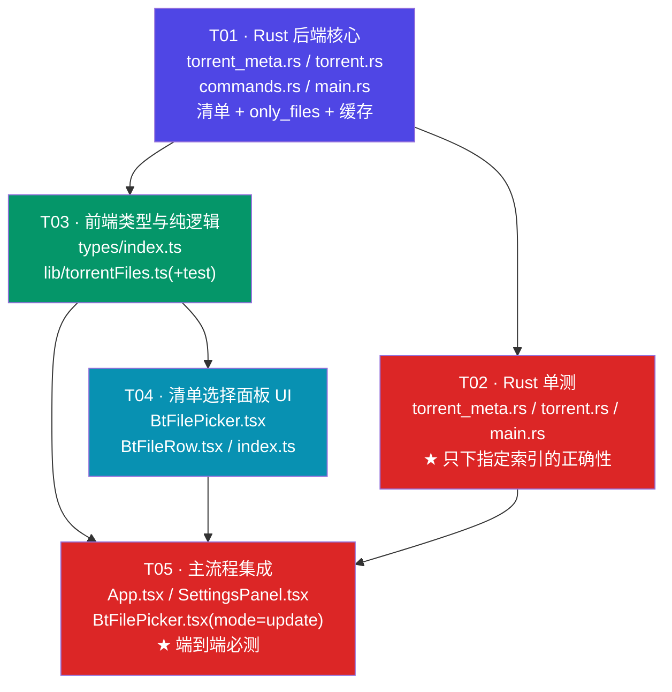
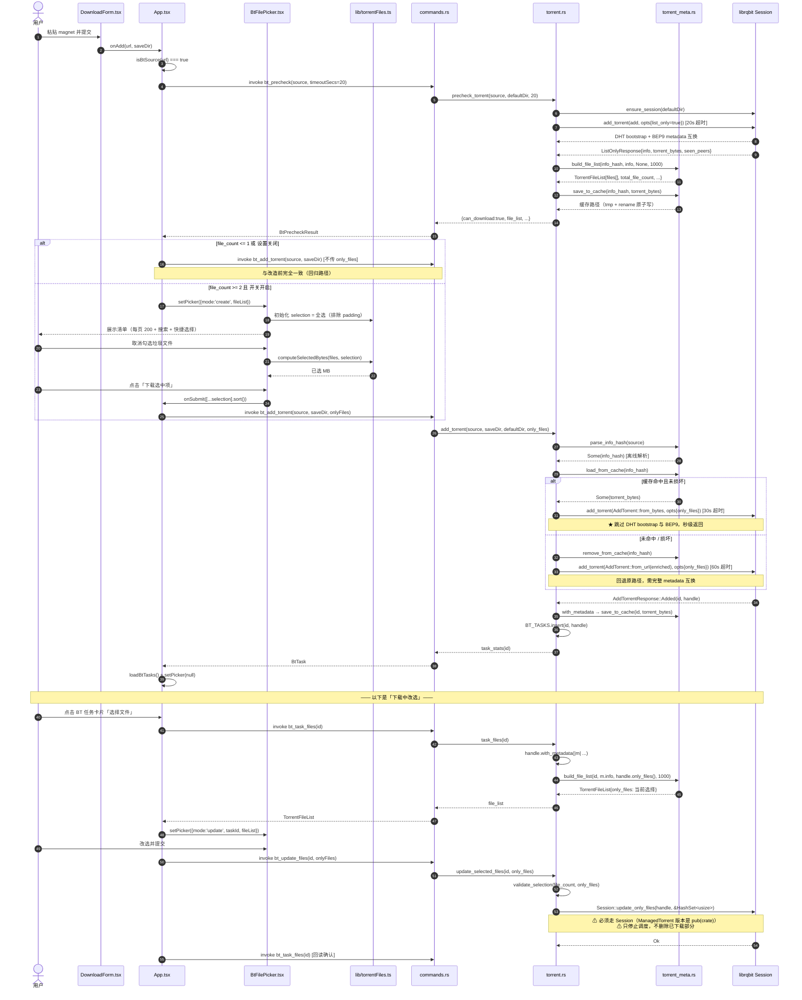

# LeLeDownload · 磁力文件清单解析 + 选择性下载 — 系统设计

> 版本：v1 · 目标仓库：`D:\tools\WorkBuddy\lele_download`（相对路径均相对此根目录）
> 上游输入：team-lead 的 PRD + 代码勘察结论
> 本文所有 librqbit API 结论均**已对 `librqbit-9.0.0` 实际源码逐条核实**（见 §0）

---

## 0. 对上游勘察结论的核实与修正（先读这一节）

我对 `~/.cargo/registry/src/index.crates.io-*/librqbit-9.0.0` 与 `librqbit-core-9.0.0` 做了源码级核对。
上游结论**大部分正确，但有 2 处会直接导致编译/逻辑错误，必须修正**，另有 3 项**上游未发现的关键能力**。

### 0.1 两处必须修正的错误

| # | 上游说法 | 实际情况（源码核实） | 影响 |
|---|---------|-------------------|------|
| ❌1 | `FileDetails` 含 `name` / `length` / `components` / `included`，index = 迭代顺序 | `librqbit-core/src/torrent_metainfo.rs:200-208`：`FileDetails` 实际字段是 **`filename: FileIteratorName`**（不是 `name`）、**`len: u64`**（不是 `length`）、`attr`(私有) / `sha1` / `symlink_path`；**没有 `components`、没有 `included`**。路径分段要用 `filename.to_vec()`（`torrent_metainfo.rs:156`），完整路径要用 `filename.to_string()`（Display impl，`torrent_metainfo.rs:138-150`）。<br>`name/components/length/included` 是 **HTTP API 层**的 `TorrentDetailsResponseFile`（`librqbit/src/api.rs:523-531`）的字段 | 照上游写**编译不过**。必须自己遍历 `iter_file_details()` 构造清单 |
| ❌2 | 可复用 librqbit 现成的文件详情构造逻辑 | 构造清单的 `make_torrent_details`（`api.rs:562`）是**私有 `fn`**（非 `pub fn`），外部无法调用 | 只能自己实现 → 这也是拆分 `torrent_meta.rs` 的理由 |

### 0.2 三项上游未发现的关键能力（本设计的基石）

| # | 能力 | 源码位置 | 价值 |
|---|------|---------|------|
| ⭐1 | **magnet 的 `ListOnlyResponse.torrent_bytes` 是完整合法的 .torrent 文件字节** | `session.rs:296-303`（字段）、`session.rs:1305`（list_only 返回时赋值）、`session.rs:1663-1667`（magnet 分支：`torrent_file_from_info_bytes(info_bytes, trackers)?` 用 BEP9 拿到的 info 字节 + trackers **重建**了完整 torrent 文件） | **彻底消灭"重复拉取 metadata"问题**：precheck 后把这份字节落盘，正式 add 时 `AddTorrent::from_bytes(缓存)`，无需二次 DHT/BEP9。详见 §2.2 |
| ⭐2 | `ManagedTorrent::with_metadata()` 是 **pub** | `torrent_state/mod.rs:239-246`，回调拿到 `Arc<TorrentMetadata>`，其 `info` / `torrent_bytes` / `file_infos` 均为 pub（`torrent_state/mod.rs:137-142`） | 已添加的任务可**离线**重列文件清单（下载中改选的基础）；也可在 add 成功后补写缓存 |
| ⭐3 | `ManagedTorrent::only_files()` 是 **pub**，且 add 与 update 后都会被写入 | `torrent_state/mod.rs:252-254`；写入点 `torrent_state/mod.rs:435`（add）、`:644`（update） | 「下载中改选」面板可正确回显当前选择，**不需要我们在 Rust 侧另存选择状态** |

### 0.3 三个易踩的语义陷阱（已核实，务必遵守）

> **陷阱 A · `ManagedTorrent::update_only_files` 是 `pub(crate)`，不能直接调。**
> `torrent_state/mod.rs:617` 是 `pub(crate) fn`。唯一公开入口是
> `Session::update_only_files(self: &Arc<Self>, handle, &HashSet<usize>)`（`session.rs:1617`），
> 且参数类型是 **`HashSet<usize>` 而非 `Vec<usize>`**。
> （`api.rs:337` 的 `api_torrent_action_update_only_files` 是 HTTP 层的封装，内部也走 `Session`。）

> **陷阱 B · 空集语义在「添加」与「改选」两条路径上不一致。**
> - 添加时 `initializing.rs:229-236`：`only_files.as_ref().map(\|o\| o.contains(&idx)).unwrap_or(true)`
>   → `None` = **全下**；`Some(vec![])` = **什么都不下**（任务会立刻"完成"但 0 字节）。
> - 改选时 `chunk_tracker.rs:328-332`：`\|idx\| new_only_files.contains(&idx)`
>   → 空 `HashSet` = **什么都不下**。
> **结论：命令层必须显式拒绝空选择**（见 §5 `validate_selection`）。

> **陷阱 C · `update_only_files` 回读顺序不确定。**
> `torrent_state/mod.rs:644`：`g.only_files = Some(only_files.iter().copied().collect())` —— 从 `HashSet` 收集，**顺序随机**。
> **结论：前端不要把回读的 `only_files` 数组与本地数组做逐位比较，必须先排序再比，或统一转 `Set<number>`。**

---

## 1. 实现方案与关键决策

### 1.1 决策一：UX 流程 —— 「多文件强制清单、单文件直下」+ 设置开关

**候选方案对比**

| 方案 | 优点 | 缺点 |
|------|------|------|
| A. 强制所有 magnet 先弹清单 | 最彻底；用户永远不会误下垃圾 | 单文件种子（磁力的很大一部分）多一次无意义点击；改变现有"粘贴即下载"肌肉记忆 |
| B. 保留全量直下，另开"选择文件"入口 | 零破坏 | 用户**默认**仍在下垃圾——而这恰恰是本需求要解决的问题；新入口藏得深等于没做 |
| **C. 推荐：按文件数分流** | | |

**推荐方案 C**
1. 粘贴 magnet → 走 **现有的 `bt_precheck`**（这一步今天已经在跑，不新增等待）→ 拿回文件清单。
2. `file_count <= 1` → **与今天完全一致**，直接添加下载，零感知变化。
3. `file_count >= 2` → 弹出 `BtFilePicker` 选择面板，**默认全选**（不替用户做"智能过滤"判断，避免误伤），
   面板提供 4 个快捷操作：`全选` / `全不选` / `仅影音字幕` / `取消常见垃圾`（`.nfo .url .lnk .exe .db .ini .htm(l) .txt` 小文件）。
   用户改完点「下载选中项 (N 个 / X MB)」。
4. `localStorage.settings.bt_ask_files`（默认 `true`）→ 关掉后多文件也直接全量下载，保留资深用户的快路径。

**为什么推荐 C —— 关键是它不增加任何等待**：
现状 `App.tsx:101-114` 已经是「precheck（12s）→ add（60s，内部**再拉一次** metadata）」，
一次添加实际做了**两遍** metadata 互换。本方案把第二次干掉（§2.2 缓存），
所以"多出一个勾选面板"不仅不慢，整体反而**更快**。这个事实让方案 C 的代价趋近于零。

**对现有用户习惯的影响评估**：单文件 magnet（占比高）行为完全不变；多文件 magnet 多一次确认点击，
但换来"不再下载几 GB 垃圾"——对本需求的目标用户（明确抱怨垃圾文件）是净收益。

---

### 1.2 决策二：清单获取时机 —— 复用 precheck + **metadata 落盘缓存**（消灭二次握手）

**结论：复用 `precheck_torrent`，并把它拿到的 `torrent_bytes` 落盘。**

**为什么"重复拉两次 metadata"这个问题可以被彻底解决**（而不是缓解）：
- `ListOnlyResponse.torrent_bytes`（`session.rs:302`）在 magnet 场景下由
  `torrent_file_from_info_bytes(info_bytes, trackers)` 重建（`session.rs:1663-1667`），是一份**完整、合法、可离线解析**的 .torrent。
- 因此 precheck 结束后把它写到 `<data_local_dir>/lele_download/torrent_cache/<info_hash>.torrent`。
- 正式添加时，从 magnet 里**离线**解析出 info_hash（`Magnet::parse(src).as_id20()`，不需要网络），
  命中缓存就走 `AddTorrent::from_bytes(cached_bytes)` —— **完全跳过 DHT bootstrap 与 BEP9 metadata 互换**。

**收益量化**
| 环节 | 现状 | 改造后 |
|------|------|--------|
| precheck | 12s（含 DHT+BEP9） | 20s（含 DHT+BEP9，超时放宽，见 §1.5） |
| add（缓存命中，99% 场景） | 60s（**再一遍** DHT+BEP9） | **30s 超时，实际秒级**（只需建 storage + 连 tracker） |
| add（缓存未命中，冷门种） | 60s | 60s（回退原路径） |

**缓存的三条写入/读取路径**
```
写：① precheck 成功（ListOnlyResponse.torrent_bytes）
    ② add 成功（handle.with_metadata(|m| m.torrent_bytes.clone())）—— 兜底 & 覆盖空 trackers 版本
    ③ 用户直接用 .torrent 文件/URL 添加（AddTorrent::from_bytes 路径拿不到原始字节时用 ② 补）
读：add_torrent 时按 info_hash 查；命中且能 bencode 解析 → 用；解析失败 → 删缓存 + 回退原路径
失效：不设 TTL（info_hash 内容寻址，metadata 永不变）；文件损坏时自愈删除
```

**并发**：同一 info_hash 被并发添加时，缓存写用「写临时文件 + rename」保证原子性，避免读到半截文件。

---

### 1.3 决策三：`only_files` 索引契约

**索引的定义与稳定性**
- `index` ≡ `info.iter_file_details().enumerate()` 的下标 ≡ torrent `info.files` 数组下标。
- `librqbit-core/src/torrent_metainfo.rs:387-401` 证实：单文件种子走 `(Some(length), None)` 分支，
  **产出 1 个 `FileDetails`**；多文件走 `files` 数组。二者**统一为同一个迭代器**，无分叉。
- 稳定性由 info-hash 保证：`info` 字典的 bencode 字节序即 info-hash 的输入，内容不变则文件数组顺序不变。
  因此 **index 在整个种子生命周期内恒定**，可以安全地 Rust → JSON → 前端 → Rust 往返。

**单文件种子的统一处理**（回答"单文件没有目录层级怎么办"）
- 无需特判。`iter_file_details()` 对单文件种子同样产出 1 项，
  其 `filename` 是 `FileIteratorNameData::Single(name)`，`to_vec()` 返回 `["xxx.mkv"]`（长度 1 的数组）。
- 退化规则：`components.length === 1` → 前端按"平铺文件"渲染，不画目录树。
- 若 `name` 缺失，`FileIteratorName` 会兜底成字符串 `"torrent-content"`（`torrent_metainfo.rs:171-173`）——
  前端直接用 `path` 字段即可，无需自己兜底。

**目录层级（多文件种子）**
- `components: Vec<String>` = 路径分段（含文件名），例如 `["Season 01", "S01E01.mkv"]`。
- `path: String` = `filename.to_string()`，用 **平台主分隔符**拼接（Display impl，`torrent_metainfo.rs:143-148`）。
  ⚠️ Windows 上是 `\`，Linux/macOS 上是 `/`。前端**只用 `path` 做展示与搜索，禁止用来拼 URL 或做跨平台比较**；
  需要结构化操作一律用 `components`。

**padding 文件（BEP-47）**
- `compute_selected_pieces`（`chunk_tracker.rs:136-142`）先 `filter(!fi.attrs.padding)` **再**应用 `only_files` 过滤，
  所以 padding 索引出现在 `only_files` 里**是安全的 no-op**。
- 但 UI 应置灰并**不计入 `selected_bytes`**（`FileDetails::attrs().padding` 可读取，`torrent_metainfo.rs:214`）。

---

### 1.4 决策四：大种子 —— 硬上限 + 前端分页，本期**不引虚拟化库**

| 维度 | 决策 |
|------|------|
| Rust 侧 payload 上限 | `MAX_LIST_FILES = 1000`。超过则只返回前 1000 条，并置 `total_file_count`（真实总数）/ `truncated: true` |
| 体积估算 | 单条约 110~150 字节 JSON（`index`+`path`+`components`+`length`）→ 1000 条 ≈ **150 KB**，Tauri IPC（JSON over 管道）可承受，无需分页 RPC |
| 前端渲染 | **每页 200 条 + 「显示更多」按钮**；配合关键词搜索框与目录折叠。不引 `react-window` 等依赖（项目极小，不值得加依赖；绝大多数种子 < 200 文件） |
| 超过上限时 | 面板顶部黄色提示：`文件过多（共 N 个），仅显示前 1000 个。已选 M 个`。**允许在截断状态下按扩展名批量操作**（这类操作在 Rust 侧不该做，所以批量选择在前端基于已列出的 1000 条执行，语义明确 = "对可见部分生效"，UI 文案需写明） |

> 备选（若后续真遇到万级文件种子）：加 `bt_list_files_paged(info_hash, offset, limit)` 分页命令。本期不做。

---

### 1.5 决策五：失败与超时

| 场景 | 处理 |
|------|------|
| **precheck 超时** | 超时从 **12s → 20s**（测试样本实测 14s，12s 太贴边，会误杀活种）。`bt_precheck` 新增可选参数 `timeout_secs`（默认 20）。超时仍返回 `can_download:false, reason:"no_metadata"`，**保持现有"弹确认是否仍要添加"的行为不变** |
| **precheck 失败后是否回退全量下载** | **不回退。** 全量下载同样需要 metadata，回退必然同样失败，只会让用户多等 60s 并看到一个更模糊的错误。正确做法是：明确告知 + 两个出口（① 重试 ② 改用 `.torrent` 文件添加，因为文件自带 metadata 无需 DHT） |
| **add 阶段超时** | 缓存命中 → **30s**（无需 metadata 互换）；未命中 → 保持 **60s**。命中判断在发起前完成，超时值随之确定 |
| **缓存损坏** | `file_list_from_bytes` 解析失败 → 删除该缓存文件 + `tracing::warn!` + 静默回退到网络路径（不让用户感知） |
| **`only_files` 越界** | `add` 前若命中缓存（已知 file_count）→ 本地 `validate_selection` 直接拒绝，返回友好错误；未命中 → 透传给 librqbit，其 `compute_only_files`（`session.rs:203-211`）会 bail `"file id N is out of range"`，我们在 `add_torrent` 里把这类错误映射为中文提示 |
| **空选择** | 硬拒绝（见陷阱 B）：`"请至少选择一个文件"` |

---

### 1.6 决策六：下载中改选 —— **本期做**

**理由**
1. API 完全现成：`Session::update_only_files`（pub）+ `ManagedTorrent::with_metadata`（pub）+ `ManagedTorrent::only_files`（pub），三个能力齐备。
2. 边际成本低：1 个 command（`bt_update_files`）+ 1 个 command（`bt_task_files`）+ 面板复用（加 `mode` prop）。
3. 价值高：大包下到一半发现某个文件是垃圾，现状只能删任务重加（重加会**再次**走 DHT）；改选可原地生效。

**必须向用户说明的两个语义**
- 改选**不会删除**已下载的未选中文件（librqbit 只停止调度其 piece）。UI 文案：「取消勾选会停止下载该文件，已下载的部分保留在磁盘上」。
- 改选后任务状态可能立刻转为 `completed`（若剩余选中文件都已下完）。这是正确行为，UI 正常显示即可。

---

## 2. 架构总览

### 2.1 分层

```
┌──────────────────────── 前端 (React 18 + TS) ────────────────────────┐
│ App.tsx          主流程编排：precheck → 分流 → BtFilePicker → add     │
│ BtFilePicker.tsx 文件清单面板（新增/改选双 mode）                      │
│ BtFileRow.tsx    单行（复选框 + 名称 + 大小 + 类型徽标）               │
│ lib/torrentFiles.ts  纯函数：选择集运算 / 字节合计 / 扩展名过滤 / 过滤 │
│ types/index.ts   TorrentFileEntry / TorrentFileList / BtPrecheckResult │
└───────────────────────────┬──────────────────────────────────────────┘
                            │ Tauri IPC (invoke, snake_case JSON)
┌───────────────────────────┴─────── Rust (Tauri 2) ───────────────────┐
│ commands.rs   bt_precheck / bt_add_torrent / bt_task_files /          │
│               bt_update_files / bt_list_tasks / bt_task_stats …      │
│ torrent.rs    Session 生命周期、BT_TASKS、任务增删查、缓存编排         │
│ torrent_meta.rs 【新增·纯逻辑】清单构造 / .torrent 解析 / 缓存读写 /    │
│                  索引校验 / info_hash 离线解析 —— 全部可无网单测        │
└───────────────────────────┬──────────────────────────────────────────┘
                            │
                     librqbit 9.0.0 (Session / ManagedTorrent)
                            │
                    DHT + BEP9 metadata + Peers
```

**为什么拆出 `torrent_meta.rs`**：`torrent.rs` 已经 419 行且全部函数绑在 `Session`/`Mutex` 上，
无法脱离网络做单测。把「清单构造 / bencode 解析 / 缓存 / 索引校验」这些**纯函数**抽到新文件，
就能对 **"只下指定索引的正确性"这一必测项写不依赖网络的单元测试**——这是本设计最重要的可测试性决策。

### 2.2 数据/控制流（一句话版）

```
magnet → bt_precheck(list_only) ──► 文件清单 ──► 勾选 ──► bt_add_torrent(only_files)
              │                                                    ▲
              └─► torrent_bytes 落盘 ─────────────────────────────┘（缓存命中，跳过 DHT）
```

---

## 3. 文件清单

| 路径 | 新建/修改 | 说明 |
|------|----------|------|
| `src-tauri/src/torrent_meta.rs` | **新建** | 清单构造 / .torrent 解析 / metadata 缓存 / 索引校验 / info_hash 离线解析（纯逻辑，含单测） |
| `src-tauri/src/torrent.rs` | 修改 | `precheck_torrent` 返回清单；`add_torrent` 支持 `only_files` + 缓存加速；新增 `task_files` / `update_selected_files`；缓存编排 |
| `src-tauri/src/commands.rs` | 修改 | 新增 `bt_task_files` / `bt_update_files`；改签名 `bt_precheck` / `bt_add_torrent` |
| `src-tauri/src/main.rs` | 修改 | `pub mod torrent_meta;` + `generate_handler!` 注册 2 个新命令 + 新增 `bt_tests` 测试模块 |
| `src/types/index.ts` | 修改 | 新增 `TorrentFileEntry` / `TorrentFileList`；`BtPrecheckResult` 增加 `file_list` |
| `src/lib/torrentFiles.ts` | **新建** | 前端纯逻辑：选择集运算、字节合计、按扩展名选择、关键词过滤、`JUNK_EXTENSIONS` |
| `src/lib/torrentFiles.test.ts` | **新建** | 前端单测（对齐 `format.test.ts` 的 `assert` 风格） |
| `src/components/BtFilePicker.tsx` | **新建** | 文件清单面板，支持 `mode: 'create' \| 'update'` |
| `src/components/BtFileRow.tsx` | **新建** | 文件行（复选框 + 路径 + 大小 + padding 徽标） |
| `src/components/index.ts` | 修改 | 导出 `BtFilePicker` / `BtFileRow` |
| `src/App.tsx` | 修改 | 主流程分流、面板挂载、BT 卡片加「选择文件」按钮、改选回调 |
| `src/components/SettingsPanel.tsx` | 修改 | 新增开关「添加磁力时先选择文件（多文件种子）」 |
| `docs/system_design.md` | **新建** | 本文 |
| `docs/class-diagram.mermaid` | **新建** | 类图 |
| `docs/sequence-diagram.mermaid` | **新建** | 时序图 |

---

## 4. 数据结构与接口

### 4.1 Rust：`src-tauri/src/torrent_meta.rs`（新建）

```rust
//! 磁力/种子的「文件清单」相关纯逻辑：不持有 Session、不依赖网络，
//! 因而可以脱离 BT 环境做单元测试。
// ⚠️ 不要写 `use librqbit::Id20;` —— librqbit 未重导出该类型（见 §6）。
use librqbit::{torrent_metainfo::ValidatedTorrentMetaV1Info, ByteBufOwned, Magnet, Session};
use serde::{Serialize, Deserialize};

/// 单条清单项 —— JSON 字段名保持 snake_case（与现有 bt_precheck 返回体一致）。
#[derive(Debug, Clone, Serialize, Deserialize)]
pub struct TorrentFileEntry {
    /// 稳定索引 = info.iter_file_details().enumerate() 的下标 = torrent info.files 数组下标
    pub index: usize,
    /// 完整相对路径（平台主分隔符；Windows 为 '\'）——仅用于展示与搜索
    pub path: String,
    /// 路径分段（末位是文件名）——前端据此渲染目录树，跨平台安全
    pub components: Vec<String>,
    /// components 的末位（单文件种子也能取到），前端列表主标题用
    pub name: String,
    pub length: u64,
    /// BEP-47 padding 文件：永远不参与下载，UI 置灰且不计入 selected_bytes
    pub is_padding: bool,
}

#[derive(Debug, Clone, Serialize, Deserialize)]
pub struct TorrentFileList {
    pub info_hash: String,
    /// 种子/磁力显示名
    pub name: String,
    pub files: Vec<TorrentFileEntry>,
    /// 种子真实文件总数（truncated 时 > files.len()）
    pub total_file_count: usize,
    /// 全部文件字节总和（含未列出的）
    pub total_bytes: u64,
    /// 当前选择（默认全选时 == total_bytes）
    pub selected_bytes: u64,
    /// 是否因超过 MAX_LIST_FILES 被截断
    pub truncated: bool,
    /// true = 清单来自本地 .torrent 缓存 / 本地文件，未走网络
    pub from_cache: bool,
    /// 当前生效的 only_files（None = 未筛选即全选；Some = 明确选择，顺序已被排序归一化）
    pub only_files: Option<Vec<usize>>,
}

/// 清单条数硬上限，防止超大种子把 IPC payload 撑爆（1000 条 ≈ 150KB JSON）。
pub const MAX_LIST_FILES: usize = 1000;

/// 从已解析的 torrent info 构造清单（纯函数，无 IO、无网络）。
/// only_files: None => 全选；Some(v) => 仅 v 中的索引被选中。
pub fn build_file_list(
    info_hash: &str,
    info: &ValidatedTorrentMetaV1Info<ByteBufOwned>,
    only_files: Option<&[usize]>,
    max_files: usize,
) -> TorrentFileList

/// 从 .torrent 文件字节离线解析出 (info_hash_hex, 清单)。
/// 缓存命中路径与单元测试共用；失败即代表缓存损坏。
pub fn file_list_from_bytes(bytes: &[u8]) -> Result<(String, TorrentFileList), String>;

/// 计算选择集对应的字节数（自动排除 padding）。
pub fn compute_selected_bytes(files: &[TorrentFileEntry], selected: &[usize]) -> u64;

/// 校验并归一化用户选择：排序 + 去重 + 越界拒绝 + 空集拒绝。
/// 返回排序去重后的 Vec<usize>。
pub fn validate_selection(file_count: usize, only_files: &[usize]) -> Result<Vec<usize>, String>;

/// 离线从 magnet / 40 位 hex 解析 info_hash（不联网）；非磁力返回 None。
pub fn parse_info_hash(source: &str) -> Option<String>;

/// metadata 缓存目录：<data_local_dir>/lele_download/torrent_cache
pub fn cache_dir() -> std::path::PathBuf;
pub fn cache_path(info_hash: &str) -> std::path::PathBuf;
/// 原子写入（tmp + rename），避免并发读到半截文件
pub fn save_to_cache(info_hash: &str, bytes: &[u8]) -> Result<std::path::PathBuf, String>;
pub fn load_from_cache(info_hash: &str) -> Option<Vec<u8>>;
pub fn remove_from_cache(info_hash: &str);
```

### 4.2 Rust：`src-tauri/src/torrent.rs`（修改）

```rust
/// 预检：新增超时参数 + 返回完整文件清单 + 写 metadata 缓存。
pub async fn precheck_torrent(
    source: String,
    default_dir: PathBuf,
    timeout_secs: u64,          // 新增，前端默认传 20
) -> Result<serde_json::Value, String>;
// 返回体（在现有字段基础上增加）：
// { can_download, reason?, info_hash?, name?, file_count?, total_bytes?,
//   seen_peers?, message, file_list?: TorrentFileList }

/// 添加：新增 only_files 参数 + 命中缓存时跳过 DHT/BEP9。
pub async fn add_torrent(
    source: String,
    save_dir: Option<String>,
    default_dir: PathBuf,
    only_files: Option<Vec<usize>>,   // 新增：None = 全量（兼容现状）
) -> Result<serde_json::Value, String>;

/// 列出「已添加任务」的文件清单（离线，从 handle 的 metadata 读）。
/// 用于「下载中改选」面板的初始数据。
pub fn task_files(id: &str) -> Result<serde_json::Value, String>;

/// 下载中改选：唯一入口是 Session::update_only_files（ManagedTorrent 版本是 pub(crate)）。
pub async fn update_selected_files(id: &str, only_files: Vec<usize>) -> Result<(), String>;
```

**`add_torrent` 内部流程（改动点用 ★ 标出）**

```
1  ensure_session(default_dir)                       // 不变
2  ★ selection = only_files.map(|v| validate_selection(file_count_known?, &v))?
3  ★ if let Some(ih) = parse_info_hash(&source) {        // 离线解析，无网络开销
       if let Some(bytes) = load_from_cache(&ih) {
           if file_list_from_bytes(&bytes).is_ok() {     // 校验缓存未损坏
               add = AddTorrent::from_bytes(bytes)        // ★ 跳过 DHT + BEP9
               timeout = 30s
           } else { remove_from_cache(&ih) }              // 自愈
       }
   }
   // 未命中 → 沿用原路径：enrich_magnet + AddTorrent::from_url，timeout = 60s
4  options.only_files = selection                     // ★ AddTorrentOptions.only_files: Option<Vec<usize>>
5  resp = session.add_torrent(add, Some(options))
6  ★ 成功且非 AlreadyManaged：
       handle.with_metadata(|m| save_to_cache(&id, &m.torrent_bytes))   // 补写/覆盖缓存
7  BT_TASKS.insert(id, handle)                        // 不变
8  return task_stats(&id)                             // 不变
```

**`task_files` 内部流程**
```
handle = BT_TASKS.get(id)?
handle.with_metadata(|m| build_file_list(
    id, &m.info, handle.only_files().as_deref(), MAX_LIST_FILES
))
// 注意：only_files() 回读的数组顺序可能随机（陷阱 C），build_file_list 内部会排序归一化
```

**`update_selected_files` 内部流程**
```
session = session_ref()?
handle  = BT_TASKS.get(id)?
// 先取真实文件数做本地校验，避免 librqbit 抛英文错误
file_count = handle.with_metadata(|m| m.file_infos.len())?
selection  = validate_selection(file_count, &only_files)?      // 空集 → Err
session.update_only_files(&handle, &selection.into_iter().collect::<HashSet<_>>()).await
//   ↑ 必须是 HashSet；Session::update_only_files(self: &Arc<Self>, handle, &HashSet<usize>)
```

### 4.3 Tauri Commands（`src-tauri/src/commands.rs` + `main.rs` 注册）

| 命令 | 类型 | 参数 | 返回 | 状态 |
|------|------|------|------|------|
| `bt_precheck` | 修改 | `source: String, timeout_secs: Option<u64>` | `Result<serde_json::Value, String>` | 现有 |
| `bt_add_torrent` | 修改 | `source: String, save_dir: Option<String>, only_files: Option<Vec<usize>>` | `Result<serde_json::Value, String>` | 现有 |
| `bt_task_files` | **新增** | `id: String` | `Result<serde_json::Value, String>` | 新 |
| `bt_update_files` | **新增** | `id: String, only_files: Vec<usize>` | `Result<(), String>` | 新 |
| `bt_list_tasks` / `bt_task_stats` / `bt_pause` / `bt_resume` / `bt_remove` | 不变 | — | — | 现有 |

> **兼容性**：`bt_add_torrent` 新增的参数是 `Option<Vec<usize>>`，
> Tauri v2 对 `Option` 参数在 `invoke` 未传时反序列化为 `None`，
> 因此**现有调用点 `App.tsx:114` 不传该参数仍可工作**（行为 = 全量，与今天一致）。
> 工程上仍建议 T05 显式传值。

### 4.4 TypeScript：`src/types/index.ts`（修改）

```ts
export interface TorrentFileEntry {
  index: number          // 稳定索引，与 Rust 侧 iter_file_details() 顺序一致
  path: string           // 完整相对路径（平台分隔符）——仅展示/搜索
  components: string[]   // 路径分段，末位为文件名——跨平台结构化操作用这个
  name: string
  length: number
  is_padding: boolean    // BEP-47 padding，置灰不计字节
}

export interface TorrentFileList {
  info_hash: string
  name: string
  files: TorrentFileEntry[]
  total_file_count: number
  total_bytes: number
  selected_bytes: number
  truncated: boolean
  from_cache: boolean
  only_files: number[] | null   // null = 未筛选（全选）
}

export interface BtPrecheckResult {
  can_download: boolean
  reason?: string
  info_hash?: string
  name?: string
  file_count?: number
  total_bytes?: number
  seen_peers?: number
  message: string
  file_list?: TorrentFileList   // 新增：can_download===true 时必定存在
}
```

### 4.5 TypeScript：`src/lib/torrentFiles.ts`（新建）

```ts
import type { TorrentFileEntry } from '../types'

/** 常见垃圾文件扩展名（用于「取消常见垃圾」快捷按钮，不做自动过滤） */
export const JUNK_EXTENSIONS = [
  '.nfo', '.url', '.lnk', '.exe', '.db', '.ini', '.htm', '.html', '.txt', '.diz', '.sfv',
] as const

/** 影音字幕扩展名（用于「仅影音字幕」快捷按钮） */
export const MEDIA_EXTENSIONS = [
  '.mp4', '.mkv', '.avi', '.mov', '.wmv', '.flv', '.webm', '.m2ts', '.ts', '.rmvb',
  '.mp3', '.flac', '.aac', '.wav', '.m4a',
  '.srt', '.ass', '.ssa', '.sub', '.idx', '.vtt',
] as const

export function extOf(f: TorrentFileEntry): string
export function computeSelectedBytes(files: TorrentFileEntry[], selected: Set<number>): number
export function toggleIndex(selected: Set<number>, index: number): Set<number>
export function selectByExt(files: TorrentFileEntry[], exts: readonly string[]): Set<number>
export function deselectByExt(selected: Set<number>, files: TorrentFileEntry[], exts: readonly string[]): Set<number>
export function filterByKeyword(files: TorrentFileEntry[], keyword: string): TorrentFileEntry[]
/** 目录分组：返回 [{ dir: string; files: TorrentFileEntry[] }]，components.length===1 时 dir 为 '' */
export function groupByDir(files: TorrentFileEntry[]): { dir: string; files: TorrentFileEntry[] }[]
/** Rust 回读的 only_files 顺序随机，必须先排序再比较（陷阱 C） */
export function sameSelection(a: Iterable<number>, b: Iterable<number>): boolean
```

---

## 5. 共享知识（跨文件约定，前后端必须对齐）

1. **JSON 字段名一律 `snake_case`**（与现有 `can_download` / `info_hash` / `file_count` / `seen_peers` 一致）。
   Rust 侧**不要**加 `#[serde(rename_all = "camelCase")]`；TS 侧字段名与之一字不差。

2. **错误一律用 `Result<_, String>`，字符串是中文、可直接展示给用户的完整句子。**
   沿用 `torrent.rs` 现有风格（如 `"添加 BT 任务超时（60s）：…请检查网络/防火墙…"`）。
   `librqbit` 的英文错误必须在 `torrent.rs` 层翻译后再上抛，禁止把 `anyhow` 原文直接给前端。

3. **索引 `index` 是唯一权威标识。**
   前端**禁止**用 `path` 或 `name` 作为文件身份（重名文件在种子里合法）；
   所有选择集一律 `Set<number>` / `Vec<usize>`，只装 `index`。

4. **选择状态的真值只存一处：librqbit 内部（`chunk_tracker.selected`）。**
   - Rust 侧**不额外维护** `HashMap<info_hash, Vec<usize>>`。
   - 需要当前选择时，永远从 `handle.only_files()` 读（`torrent_state/mod.rs:252`）。
   - 前端 `useState<Set<number>>` 只是**渲染态**，面板打开时用后端返回值初始化，提交后以 `bt_task_files` 回读结果为准。
   - ⚠️ 回读数组**顺序随机**（陷阱 C），比较前先排序：`sameSelection()`。

5. **`None` 与 `Some([])` 语义不同，永不混淆。**
   - `only_files = None`（Rust）/ `null`（TS）= **全选**（未筛选）。
   - `Some([])` / `[]` = **非法**，命令层拒绝。前端「下载选中项」按钮在 `selected.size === 0` 时必须 `disabled`。

6. **平台路径分隔符**：`path` 字段在 Windows 上含 `\`。
   前端只用其做展示/搜索；结构化操作一律用 `components`。

7. **`padding` 文件（`is_padding === true`）**：UI 复选框置灰禁用，且**不计入** `selected_bytes` / 「已选 N 个」计数。
   允许它们留在选择集里（Rust 侧是 no-op），但展示上要隐藏或标灰。

8. **metadata 缓存目录**：`dirs::data_local_dir()/lele_download/torrent_cache/<info_hash_hex>.torrent`
   （与现有 `settings.json` 同级父目录，见 `commands.rs:19-23` 的 `settings_path()` 约定）。
   文件名**统一小写 hex**（`Id20::as_string()` 已是小写）。

9. **日志**：沿用 `tracing::info!/warn!`，前缀统一 `[bt]`，与 `torrent.rs:152` 现有风格一致。

10. **BOM / 编码**：`src/types/index.ts` 与 `src/components/index.ts` 现有文件带 UTF-8 BOM，
    新增的 `src/lib/torrentFiles.ts` **不带 BOM**（Vite 无要求，保持一致即可）；
    `src-tauri/src/*.rs` 不带 BOM。

11. **前端样式规范**沿用 `NetdiskPanel.tsx`：外层 `max-w-3xl mx-auto space-y-4`、
    卡片 `bg-white/70 backdrop-blur rounded-2xl shadow-sm border border-white/40 p-5`、
    主按钮 `bg-indigo-600 hover:bg-indigo-700`、成功/加入类按钮 `bg-emerald-600`。
    Tailwind 已配置，不引新 UI 依赖。

---

## 6. 人员分工前必读：Rust 侧编译注意事项

| 事项 | 说明 |
|------|------|
| `pub mod torrent_meta;` | 必须加到 `src-tauri/src/main.rs` 的模块声明区（与 `mod torrent;` 相邻） |
| 导入路径 | `FileDetails`、`ValidatedTorrentMetaV1Info`、`FileIteratorName` 由 `librqbit::torrent_metainfo::*` 重导出（`lib.rs:109`）。`use librqbit::{ValidatedTorrentMetaV1Info, ByteBufOwned};` 可用 |
| `ByteBufOwned` | ✅ **已核实可用**。定义在 `librqbit-buffers-9.0.0/src/lib.rs:15`，经 `librqbit/src/lib.rs:105` 的 `pub use buffers::*;` 重导出 → `librqbit::ByteBufOwned` |
| magnet 解析 | `use librqbit::Magnet;`（`lib.rs:107` 重导出 `librqbit_core::magnet::*`）。`Magnet::parse(s)` → `anyhow::Result<Magnet>`；`.as_id20()` → `Option<Id20>`；`.as_string()` = `hex::encode`（**小写** hex，见 `hash_id.rs:15`） |
| ⚠️ `Id20` **不可导入** | ❌ `librqbit` **没有**重导出 `Id20`（`lib.rs` 全文件无 `Id20`；`librqbit-core` 的 `torrent_metainfo.rs:11` 是私有 `use crate::hash_id::Id20`，非 `pub use`）。**不要写 `use librqbit::Id20;`**（编译失败）。<br>✅ 正确写法（链式调用，靠类型推断，不点名类型）：<br>`Magnet::parse(&source).ok().and_then(\|m\| m.as_id20()).map(\|h\| h.as_string())`<br>任务侧则用现成的 `handle.info_hash().as_string()` |
| `HashSet` | `update_only_files` 需要 `std::collections::HashSet<usize>` |
| `FileDetails` 的 `attrs()` | `d.attrs().padding` 可读；`attr` 字段本身是**私有**的，别直接访问 |
| 无 lib target | 本 crate 是二进制，跑测试只能用 `cargo test <过滤名>`，**不能** `cargo test --lib` |
| 编译耗时 | 建议用 `cargo check` 而非 `cargo build` 做快速反馈（项目已有 `.cargocheck*.log` 的先例） |

---

## 7. Anything UNCLEAR / 假设

| # | 假设 | 若不成立的影响 |
|---|------|---------------|
| A1 | 假设 `handle.only_files()` 在 `add` 时被正确写入（源码 `torrent_state/mod.rs:435` 显示会写） | 若实测为 `None`，`task_files` 的回显会退化成"全选"，需在 `torrent.rs` 侧补一个 `BT_SELECTIONS` 旁表。**T01 完成后必须实测验证** |
| A2 | 假设 librqbit 的 `FilesystemStorageFactory` 对**未选中**文件不创建 0 字节占位（源码显示文件是在写 piece 时 lazy 打开，`storage/filesystem/fs.rs:142-161`） | 若实测会创建空文件，验收标准从"文件不存在"放宽为"文件大小为 0"，但**下载字节数仍必须为 0** |
| A3 | 假设测试样本 `magnet:?xt=urn:btih:9C08401EDA498BF1561F9668EA0A1597E2B30CA3`（4873 字节 metadata）是**多文件**种子 | 若是单文件种子，需另找多文件样本验证清单 UI；T02 的单测不依赖样本（可造 fixture），但 T05 的联调需要 |
| A4 | 假设 `dirs::data_local_dir()` 在目标 Windows 环境可写 | 若不可写，缓存静默降级（写失败只 warn，不影响主流程） |
| A5 | 假设前端 `App.tsx` 的 `withTimeout` 包装仍然适用于新流程 | 改造后 add 走缓存是秒级，45s/70s 的前端兜底可保留不变，或收紧到 35s |

---

## 8. 任务分解（按依赖顺序，共 5 个任务）

> 依赖说明：T02/T03 均只依赖 T01；T04 依赖 T03；T05 依赖 T03+T04。
> 每条都给出了**可执行的验收标准**，其中「只下指定索引的正确性」是 T02 与 T05 的**必测项**。

---

### T01 · Rust 后端核心：清单解析 + only_files + metadata 缓存

- **优先级**：P0
- **依赖**：无
- **涉及文件**
  - `src-tauri/src/torrent_meta.rs` **新建**
  - `src-tauri/src/torrent.rs` 修改
  - `src-tauri/src/commands.rs` 修改
  - `src-tauri/src/main.rs` 修改（`pub mod torrent_meta;` + 注册 `bt_task_files` / `bt_update_files`）

- **实现要点**
  1. `torrent_meta.rs`：按 §4.1 实现 `TorrentFileEntry` / `TorrentFileList` / `MAX_LIST_FILES` /
     `build_file_list` / `file_list_from_bytes` / `compute_selected_bytes` / `validate_selection` /
     `parse_info_hash` / 缓存四件套（`cache_dir` / `cache_path` / `save_to_cache` / `load_from_cache` / `remove_from_cache`）。
     - `build_file_list` 遍历 `info.iter_file_details().enumerate()`，
       每项取 `d.filename.to_string()` → `path`、`d.filename.to_vec()` → `components`、
       `components.last()` → `name`、`d.len` → `length`、`d.attrs().padding` → `is_padding`。
       ⚠️ **不是** `d.name` / `d.length` / `d.components`（见 §0.1）。
     - `save_to_cache` 用 tmp + `std::fs::rename` 保证原子。
  2. `torrent.rs`：`precheck_torrent` 加 `timeout_secs`（默认 20，替换硬编码 12）、
     成功分支调用 `build_file_list` 并把 `torrent_bytes` 写入缓存、返回体加 `file_list`；
     `add_torrent` 加 `only_files` 参数并按 §4.2 的流程图改造（缓存命中 → `AddTorrent::from_bytes` + 30s 超时；
     未命中 → 原路径 + 60s 超时；成功后 `with_metadata` 补写缓存）；
     新增 `task_files` / `update_selected_files`。
     ⚠️ `update_selected_files` 必须走 `Session::update_only_files(&handle, &HashSet<usize>)`，
     不能直接调 `ManagedTorrent::update_only_files`（`pub(crate)`）。
  3. `commands.rs`：按 §4.3 调整/新增 4 个命令；`bt_precheck` 签名加 `timeout_secs: Option<u64>`。
  4. 把 librqbit 的英文错误（`file id N is out of range` / `only_files contains invalid value N`）映射为中文。

- **验收标准**
  - [ ] `cargo check` **零 error、零新增 warning**（`cargo check 2>&1 | tee .cargocheck_bt.log`）
  - [ ] `bt_precheck` 对测试样本返回 `can_download:true` 且 `file_list.files` 非空，
        `file_list.total_file_count` 与 `file_count` 一致
  - [ ] 连续调用两次 `bt_precheck`，第二次 `file_list.from_cache === true` 且**耗时 < 1s**（证明缓存生效）
  - [ ] `bt_add_torrent` 传 `only_files=[k]` 后，任务 `total_bytes` **显著小于** `file_list.total_bytes`
        （证明选择生效，而非全量）
  - [ ] 缓存目录生成 `<data_local_dir>/lele_download/torrent_cache/<info_hash>.torrent`，文件可被标准 bencode 解析
  - [ ] `validate_selection(10, [3,1,1,99])` → `Err`（越界）；`validate_selection(10, [])` → `Err`（空集）；
        `validate_selection(10, [3,1,1])` → `Ok([1,3])`（排序去重）
  - [ ] 不传 `only_files` 调用 `bt_add_torrent`，行为与改造前**完全一致**（回归）
  - [ ] `A1` 假设验证：`bt_task_files` 返回的 `only_files` 与添加时传入的一致（顺序可不同，内容必须一致）

---

### T02 · Rust 单元测试：BT 清单 / 索引 / 缓存正确性

- **优先级**：P0（**含必测项**）
- **依赖**：T01
- **涉及文件**
  - `src-tauri/src/torrent_meta.rs` 修改（追加 `#[cfg(test)] mod tests`）
  - `src-tauri/src/torrent.rs` 修改（追加 `#[cfg(test)] mod tests`）
  - `src-tauri/src/main.rs` 修改（追加 `#[cfg(test)] mod bt_tests`）

- **实现要点**
  1. **构造离线 fixture**：在 `torrent_meta.rs` 的测试模块里硬编码一段
     **多文件** torrent 的 bencode 字节（建议手工造一个 3~5 文件、含 1 个 padding 文件的 torrent，
     或用 `librqbit::create_torrent` 生成后把字节以 `const FIXTURE: &[u8] = &[…]` 内联）。
     **测试全程不联网**——这是能进 CI / 能反复跑的前提。
  2. `torrent_meta.rs` 测试：
     - `file_list_from_bytes(FIXTURE)` 解析出的 `index` 从 0 连续递增、`files.len() == total_file_count`
     - `components` 与 `path` 与预期一致（`path` 用 `MAIN_SEPARATOR` 拼接）
     - 单文件 torrent fixture → `files.len() == 1` 且 `components.len() == 1`（验证 §1.3 的统一处理）
     - `compute_selected_bytes`：全选 == `total_bytes`（排除 padding）；选 1 个文件 == 该文件 `length`；
       选中的都是 padding → 0
     - `validate_selection`：排序 / 去重 / 越界 Err / 空集 Err / 全选 Ok
     - `parse_info_hash`：`magnet:?xt=urn:btih:<40hex>` → `Some(小写hex)`；
       40 位裸 hex → `Some(...)`；`http://…/a.torrent` → `None`；非法串 → `None`
     - 缓存往返：`save_to_cache` → `load_from_cache` 字节相等；写坏文件 → `file_list_from_bytes` 返回 Err
     - `MAX_LIST_FILES` 截断：造 >1000 文件的 info（可用程序生成一次后内联断言逻辑），
       验证 `truncated == true` 且 `total_file_count > files.len()`
  3. `main.rs` 的 `bt_tests` 模块（对齐现有 `http_tests` 风格）：
     - 端到端式的**契约测试**：用真实测试样本 magnet 调用 `precheck_torrent`，
       断言 `file_list.files[*].index` 与随后 `add_torrent(only_files=[...])` 用的索引**同源**；
       断言添加后 `task_stats` 的 `total_bytes` 等于 `compute_selected_bytes(files, selection)`（**只下指定索引的正确性 · 必测项**）
     - ⚠️ 该用例**需要网络**，必须用 `#[ignore]` 标注，并在文档注释里写明
       `cargo test bt_tests -- --ignored --nocapture`
  4. `torrent.rs` 测试：纯逻辑分支（如错误映射、`truncated` 时的 JSON 组装）。

- **验收标准**
  - [ ] `cargo test torrent_meta` 全绿，**不产生任何网络访问**（拔网线/`--offline` 也能过）
  - [ ] `cargo test bt_tests` 全绿（`#[ignore]` 的联网用例不计入默认运行，但单独跑必须过）
  - [ ] **必测项**：对测试样本只选 1 个非 padding 小文件添加任务，
        `task_stats().total_bytes` 必须 **等于** 该文件的 `length`（误差 0），
        且 **不等于** `file_list.total_bytes`
  - [ ] **必测项**：对测试样本只选 1 个文件，等待下载完成后，
        磁盘上**只有**该文件被创建（`A2` 假设验证；若会创建 0 字节占位，则断言其大小为 0 并更新本文 §7 A2）
  - [ ] 测试总耗时 < 30s（非 `#[ignore]` 部分）
  - [ ] `cargo test` 全量跑一遍，**不得破坏**现有 ~30 个 `http_tests` 与 ~14 个 `download.rs` 测试

---

### T03 · 前端类型与纯逻辑（含单测）

- **优先级**：P1
- **依赖**：T01（只需 Rust 侧的 JSON 契约定稿）
- **涉及文件**
  - `src/types/index.ts` 修改
  - `src/lib/torrentFiles.ts` **新建**
  - `src/lib/torrentFiles.test.ts` **新建**

- **实现要点**
  1. `types/index.ts`：按 §4.4 新增 `TorrentFileEntry` / `TorrentFileList`，扩展 `BtPrecheckResult`。
  2. `torrentFiles.ts`：按 §4.5 实现全部纯函数。
     - `sameSelection` 必须先排序再比较（**陷阱 C**）
     - `computeSelectedBytes` 要跳过 `is_padding`
     - `filterByKeyword` 对 `path` 做大小写不敏感包含匹配
     - `groupByDir` 对 `components.length === 1` 的文件归入 `dir: ''`
  3. `torrentFiles.test.ts`：对齐 `format.test.ts` 的 `assert(cond, msg)` + `passed/failed` 计数风格
     （该风格不依赖 `tsx`，但 `format.test.ts` 头部注明用 `npx tsx` 运行；本测试同样
     `npx tsx src/lib/torrentFiles.test.ts`，并在文件头写明运行命令）。
     覆盖：选择集切换、字节合计（含 padding 排除）、按扩展名选/反选、关键词过滤、
     目录分组（单文件 vs 多文件）、`sameSelection` 对**乱序数组**返回 true（陷阱 C 的回归测试）。

- **验收标准**
  - [ ] `npx tsc --noEmit` 零错误
  - [ ] `npx tsx src/lib/torrentFiles.test.ts` 全绿（`FAIL: 0`）
  - [ ] TS 侧接口字段名与 §4.1 的 Rust `#[derive(Serialize)]` 输出**逐字一致**（对照 `snake_case`）
  - [ ] `sameSelection([1,2,3],[3,1,2]) === true`（陷阱 C 回归）

---

### T04 · 文件清单选择面板 UI

- **优先级**：P1
- **依赖**：T03
- **涉及文件**
  - `src/components/BtFilePicker.tsx` **新建**
  - `src/components/BtFileRow.tsx` **新建**
  - `src/components/index.ts` 修改（导出两个新组件）

- **实现要点**
  1. `BtFilePicker` props：
     ```ts
     type Mode = 'create' | 'update'
     interface Props {
       mode: Mode
       source?: string          // mode==='create' 时必填（原始 magnet / 路径）
       taskId?: string          // mode==='update' 时必填
       fileList: TorrentFileList
       saving?: boolean
       onCancel: () => void
       onSubmit: (selected: number[]) => void | Promise<void>
     }
     ```
  2. 结构（沿用 `NetdiskPanel.tsx` 的卡片/间距/配色，见 §5.11）：
     - 顶部：种子名 + `共 N 个文件 / X MB` + `from_cache` 时显示「本地缓存 · 解析秒开」绿色徽标
     - 工具栏：搜索框 · `全选` / `全不选` / `仅影音字幕` / `取消常见垃圾` 四个按钮
     - 文件列表：每页 200 条 + 「显示更多 (剩余 M)」按钮；
       目录名用浅灰分隔行（复用 `groupByDir`）
     - `is_padding` 的项：复选框 `disabled` + 灰色 + 行尾 `padding` 徽标
     - 底部固定条：`已选 M / N 个 · Y MB` + 「下载选中项」/「应用选择」按钮，
       `selected.size === 0` 时 `disabled`
     - `truncated === true` 时顶部黄色提示（文案见 §1.4）
  3. 交互细节：
     - 目录行提供「该目录全选/全不选」（基于 `components` 前缀匹配）
     - 点击文件名行任意位置 = 切换该行复选框（padding 行除外）
     - 选择态用 `useState<Set<number>>`，初始值来自 `fileList.only_files ?? 全选`
  4. `BtFileRow`：复选框 + 缩进（按 `components.length - 1`）+ 名称 + `formatBytes(length)` +
     扩展名徽标；`truncate` 防超长路径溢出，配 `title={path}` 悬浮全显。

- **验收标准**
  - [ ] `npx tsc --noEmit` 零错误；`npm run build` 通过
  - [ ] 面板在 1000 条数据下首屏渲染 < 500ms（分页 200 条 + 「显示更多」）
  - [ ] 勾选/取消后底部「已选 M 个 · Y MB」实时更新，数值与 `computeSelectedBytes` 一致
  - [ ] 全选时 Y MB **等于** `fileList.total_bytes` 的格式化结果（padding 已排除）
  - [ ] 「仅影音字幕」后，非影音/字幕/非 padding 项全部取消勾选
  - [ ] padding 行无法勾选
  - [ ] `selected.size === 0` 时提交按钮 disabled

---

### T05 · 主流程集成 + 下载中改选 + 设置开关

- **优先级**：P0（功能闭环）
- **依赖**：T03、T04
- **涉及文件**
  - `src/App.tsx` 修改
  - `src/components/SettingsPanel.tsx` 修改
  - `src/components/BtFilePicker.tsx` 修改（补 `mode='update'` 分支的文案与回调）

- **实现要点**
  1. `App.tsx` 新增状态：
     ```ts
     const [picker, setPicker] = useState<
       | { mode: 'create'; source: string; fileList: TorrentFileList; saveDir?: string }
       | { mode: 'update'; taskId: string; fileList: TorrentFileList }
       | null
     >(null)
     ```
  2. `addDownload` 的 BT 分支改造（替换现 `App.tsx:97-115`）：
     ```
     pre = await withTimeout(invoke('bt_precheck', { source, timeoutSecs: 20 }), 45000, 'BT 资源预检')
     if (pre.can_download === false) { 沿用现有 confirm 逻辑 }
     const list = pre.file_list
     const ask = list ? list.total_file_count > 1 : false
     const enabled = JSON.parse(localStorage.getItem('settings') || '{}').bt_ask_files !== false
     if (!list || !ask || !enabled) {           // 单文件 / 关闭开关 / 拿不到清单
       await withTimeout(invoke('bt_add_torrent', { source, saveDir: dir }), 70000, '添加 BT 任务')
     } else {
       setPicker({ mode: 'create', source, fileList: list, saveDir: dir })   // 弹面板
     }
     ```
     ⚠️ `isAdding` 的复位时机：弹面板时**不要**保持 `isAdding=true`（否则输入框一直 loading）；
     改为 `finally` 里复位，提交时再单独置位。
  3. 面板提交（`mode==='create'`）：
     ```
     await withTimeout(invoke('bt_add_torrent', { source, saveDir, onlyFiles: [...selected].sort((a,b)=>a-b) }), 35000, '添加 BT 任务')
     await loadBtTasks(); setPicker(null)
     ```
     （走缓存是秒级，前端兜底可从 70s 收紧到 35s）
  4. BT 任务卡片（`App.tsx:182-202`）的操作区加一个按钮（图标建议 `ListTree` 或 `Files`，来自已有的 `lucide-react`）：
     ```
     onClick = async () => {
       const list = await invoke<TorrentFileList>('bt_task_files', { id: t.id })
       setPicker({ mode: 'update', taskId: t.id, fileList: list })
     }
     ```
  5. 改选提交（`mode==='update'`）：
     ```
     await invoke('bt_update_files', { id: taskId, onlyFiles: sortedArray })
     // 关闭面板前用 bt_task_files 回读一次，确认选择已生效（对陷阱 C 的双重保险）
     await loadBtTasks(); setPicker(null)
     ```
  6. `SettingsPanel.tsx`：在现有设置项后加一个开关
     「添加磁力时先选择文件（多文件种子）」，写入 `localStorage.settings.bt_ask_files`（默认 `true`）。
     复用该组件现有的开关样式与保存逻辑，不新造模式。

- **验收标准**
  - [ ] `npx tsc --noEmit` 零错误；`npm run build` 通过
  - [ ] 粘贴**单文件** magnet → **不弹面板**，行为与改造前完全一致（回归）
  - [ ] 粘贴**多文件** magnet → 弹出清单面板，默认全选，底部显示「已选 N/N 个 · 全量 MB」
  - [ ] **必测项（端到端）**：用测试样本只勾选 1 个小文件 → 点「下载选中项」→
        ① BT 任务出现在列表；② 任务的 `total_bytes` ≈ 该文件大小（不是全量）；
        ③ 下载完成后磁盘上**不存在**未勾选的文件（`A2` 验证，同 T02）
  - [ ] 二次添加同一 magnet → 二次 precheck `from_cache === true`，面板几乎瞬间出现（< 1s）
  - [ ] 已有多文件 BT 任务 → 点「选择文件」→ 面板回显当前选择（与 `only_files` 一致）→
        取消若干 → 应用 → 任务 `total_bytes` 下降，进度条重算
  - [ ] 关闭设置开关后，多文件 magnet 直接全量下载（与改造前一致）
  - [ ] 断网状态下粘贴 magnet → 20s 后给出「无活跃做种者」提示 + confirm，
        **不出现**前端假死或 `isAdding` 卡死
  - [ ] 全量回归：HTTP 下载 / 网盘解析面板 / 设置 / 更新检查均不受影响

---

## 9. Required Packages

**无新增第三方依赖。** 全部使用项目既有依赖：

| 依赖 | 版本 | 用途 | 状态 |
|------|------|------|------|
| `librqbit` | `9`（已锁 9.0.0） | BT 会话、`AddTorrentOptions.only_files`、`Session::update_only_files`、`iter_file_details()`、metadata 缓存字节 | 现有，无需加 feature |
| `serde` / `serde_json` | `^1.0` | 结构体序列化与命令返回值 | 现有 |
| `url` | `^2.5` | tracker URL 解析（现有逻辑） | 现有 |
| `dirs` | `^5.0` | 缓存目录定位（与 `commands.rs::settings_path()` 同款） | 现有 |
| `tokio` | `^1.43` | 超时包装 | 现有 |
| `react` / `react-dom` | `^18.3` | UI | 现有 |
| `lucide-react` | `^0.468` | 图标（新增按钮用现成图标） | 现有 |
| `tailwindcss` | `^3.4` | 样式（沿用 NetdiskPanel 规范） | 现有 |

> 明确**不引入**：虚拟化列表库（`react-window` / `react-virtuoso`）、状态管理库、组件库。
> 理由见 §1.4（分页足够）与 §5.11（Tailwind 已覆盖）。

---

## 10. Task Dependency Graph



**并行建议**：T02 与 T03 可并行（T02 在 Rust 侧、T03 在前端侧，只共享 JSON 契约）；
T04 需要 T03 的类型与工具函数；T05 最后收口。
**最短关键路径**：T01 → T03 → T04 → T05（T02 可与 T03/T04 并行推进，但必须在 T05 验收前完成）。

---

## 11. 时序图

完整版见 `docs/sequence-diagram.mermaid`，此处内联主流程：



---

## 12. 待明确事项（需用户/team-lead 拍板）

| # | 问题 | 我的默认建议 | 影响面 |
|---|------|-------------|--------|
| Q1 | 多文件 magnet **默认弹清单**是否可接受？（会多一次点击） | **接受**（本需求的核心诉求就是避免下垃圾；且因缓存改造，整体反而更快） | 决定方案 C 是否落地；若不接受则退化为方案 B（新入口藏深、效果打折） |
| Q2 | 「取消常见垃圾」的扩展名黑名单是否需要**持久化可配置**？ | 本期**硬编码**在 `torrentFiles.ts`，不做设置项 | 若需要，SettingsPanel 要加一个标签/输入框，T05 增加工作量 |
| Q3 | metadata 缓存是否需要容量上限 / 定期清理？ | 本期**不设上限**（单个 .torrent 通常 < 1MB，累积极慢）；若用户量大再加 LRU | 低。若需要，T01 增加容量管理逻辑 |
| Q4 | 是否需要支持「下载完成后自动删除未选中的 0 字节占位文件」（如 A2 假设不成立）？ | 本期**不做**（风险高，可能误删用户数据）；只在 UI 文案说明 | 取决于 T02 的 A2 实测结果 |
| Q5 | 改选后是否要弹二次确认？ | **不弹**（可随时再改选，成本低，无破坏性） | 低 |
| Q6 | 是否需要在 BT 任务卡片上直接显示「已选 N/M 个文件」？ | **建议做**（`bt_task_files` 成本极低，信息价值高）；若不要求可省一次 RPC | 影响 T05 细节 |

---

## 13. 附录：关键源码索引（供工程师直接跳转核对）

| 结论 | 文件:行 |
|------|--------|
| `FileDetails` 真实字段 `filename` / `len` | `librqbit-core-9.0.0/src/torrent_metainfo.rs:200-208` |
| `FileIteratorName::to_vec()` / `to_pathbuf()` / Display | `librqbit-core-9.0.0/src/torrent_metainfo.rs:156 / 161 / 138-150` |
| 单文件种子也产出 1 个 FileDetails | `librqbit-core-9.0.0/src/torrent_metainfo.rs:391-401` |
| `iter_file_details()` / `iter_file_details_ext()` | `librqbit-core-9.0.0/src/torrent_metainfo.rs:280-303` |
| `FileDetails::attrs()`（取 padding） | `librqbit-core-9.0.0/src/torrent_metainfo.rs:214` |
| `AddTorrentOptions.only_files: Option<Vec<usize>>` | `librqbit-9.0.0/src/session.rs:252` |
| `ListOnlyResponse{ torrent_bytes }` | `librqbit-9.0.0/src/session.rs:296-303` |
| list_only 返回时赋值 torrent_bytes | `librqbit-9.0.0/src/session.rs:1305` |
| **magnet 重建完整 .torrent 字节** | `librqbit-9.0.0/src/session.rs:1663-1667`（`torrent_file_from_info_bytes`） |
| `compute_only_files` 越界 bail | `librqbit-9.0.0/src/session.rs:193-226` |
| 添加时 only_files 过滤（None=全下） | `librqbit-9.0.0/src/torrent_state/initializing.rs:229-236` |
| `Session::update_only_files`（pub，HashSet） | `librqbit-9.0.0/src/session.rs:1617-1625` |
| `ManagedTorrent::update_only_files`（**pub(crate)**） | `librqbit-9.0.0/src/torrent_state/mod.rs:617-644` |
| 改选后 `only_files` 由 HashSet 收集（顺序随机） | `librqbit-9.0.0/src/torrent_state/mod.rs:644` |
| `ManagedTorrent::only_files()`（pub） | `librqbit-9.0.0/src/torrent_state/mod.rs:252-254` |
| `ManagedTorrent::with_metadata()`（pub） | `librqbit-9.0.0/src/torrent_state/mod.rs:239-246` |
| `TorrentMetadata{info, torrent_bytes, file_infos}` | `librqbit-9.0.0/src/torrent_state/mod.rs:137-142` |
| `compute_selected_pieces`（padding 先过滤） | `librqbit-9.0.0/src/chunk_tracker.rs:131-148` |
| 改选时 `contains` 语义（空集=全不选） | `librqbit-9.0.0/src/chunk_tracker.rs:328-332` |
| `make_torrent_details` 是**私有** fn | `librqbit-9.0.0/src/api.rs:562` |
| 文件在写 piece 时 lazy 创建 | `librqbit-9.0.0/src/storage/filesystem/fs.rs:142-161` |
| LeLe 现有 BT 实现 | `src-tauri/src/torrent.rs:111`(add) / `:198`(precheck) / `:310`(stats) |
| LeLe 现有命令注册 | `src-tauri/src/main.rs:173-178` |
| LeLe 现有前端主流程 | `src/App.tsx:84-130` |
